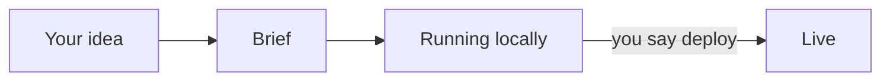

# New Project Prompt

**Paste one prompt into an empty folder. Get a running app, built right.**

Your coding agent writes the brief, builds the smallest working version and runs it on your machine. A few markdown files stay in the project, so every agent keeps following the same senior-dev standards and hard rules against surprise cloud and AI bills. When you're ready, say **deploy**.

Markdown only: no code, no CLI, nothing to install. Works with Codex, Claude Code and any agent that reads [`AGENTS.md`](https://agents.md).




## Quick start

1. Open your agent (`codex`, `claude`, …) in an empty folder.
2. Paste this, with your idea at the end:
   ```text
   Start a new project here from github.com/jessetinell/new-project-prompt: copy the contents of its template/ folder here, then follow START_HERE.md. 
   
   Here's my idea: 
   ```


## Why use it

- **One prompt, running app.** The agent writes the brief in your words, asks only what's blocking and picks sane defaults for the rest.
- **Local first, one-word deploy.** Nothing touches the cloud until you say "deploy". Then the agent does all of it: resources, secrets, access control, docs.
- **No surprise bills.** Hard rules against loops, retry storms and runaway fan-out. Every paid call has a cap and a written worst case before it ships.
- **Senior-dev habits.** The smallest change that works, reuse before writing, platform features before code, a test for anything tricky.
- **Secure by default.** Secrets live in secret stores, private apps are protected from the first deploy, and agents are set up to resist prompt injection.
- **Calm UI.** Minimal and Apple-like: less text, clear hierarchy, light and dark mode.
- **Any agent.** The standard `AGENTS.md`, plus a three-line `CLAUDE.md` for Claude Code.


## What your project gets

```text
your-project/
├── AGENTS.md              rules every agent reads first
├── CLAUDE.md              points Claude Code at the same rules
├── README.md
└── docs/
    ├── BRIEF.md           what to build, in your words
    ├── STANDARDS.md       philosophy, stack, deploy, security, UI
    ├── COST_CAUTIONS.md   runaway-cost rules + this project's limits
    └── HOSTING.md         links, setup and deploy (filled at first deploy)
```

…plus your app. It's all short enough to read in ten minutes: [`template/`](template/).


## Defaults

Override any of them in your idea, e.g. "…on Vercel" or "…with SvelteKit".


|         |                               |
| ------- | ----------------------------- |
| Web     | Next.js                       |
| Native  | Flutter                       |
| Hosting | Cloudflare, or Vercel         |
| Tests   | the runtime's built-in runner |
| UI      | minimal, calm, light and dark |


## Existing projects

Add the rules:

```text
Add the rules from github.com/jessetinell/new-project-prompt to this project: copy template/AGENTS.md, template/CLAUDE.md and template/docs/ here (merge with any existing AGENTS.md or CLAUDE.md), then fill them in from the existing code. Don't change any app code.
```

Pull the latest standards:

```text
Update docs/STANDARDS.md and the fixed part of docs/COST_CAUTIONS.md from github.com/jessetinell/new-project-prompt (template/docs/). Keep this project's own sections, and show me what changed.
```

## Make it yours

It's opinionated on purpose. Fork it, change `template/docs/STANDARDS.md` to your stack and taste, and use your fork's URL (or a local path) in the prompt. Links your whole team shares, like a hosting dashboard, can go straight into the template.

## Contributing

The best improvements are lessons from real projects. See [CONTRIBUTING.md](CONTRIBUTING.md).

## License

[MIT](LICENSE)
